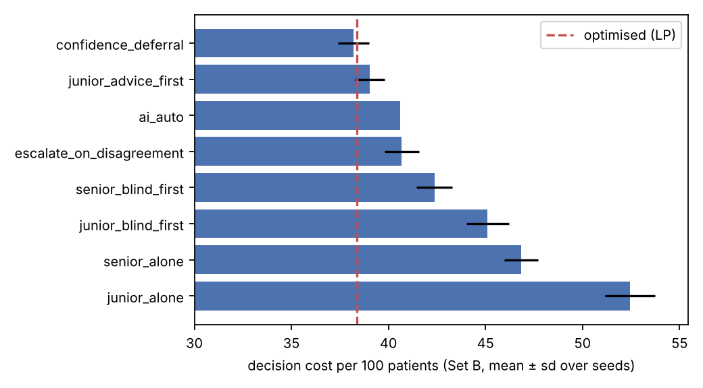
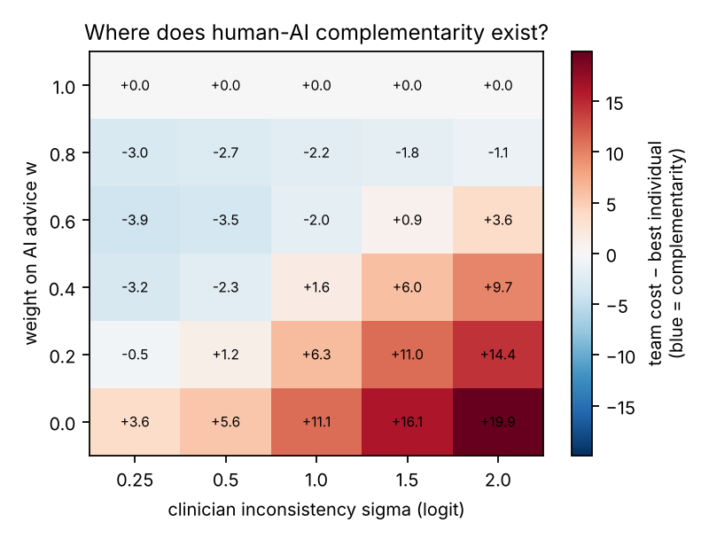
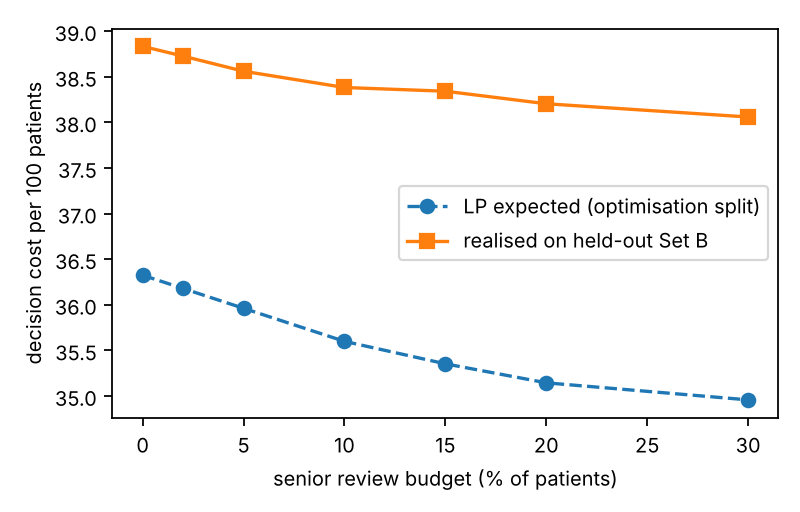
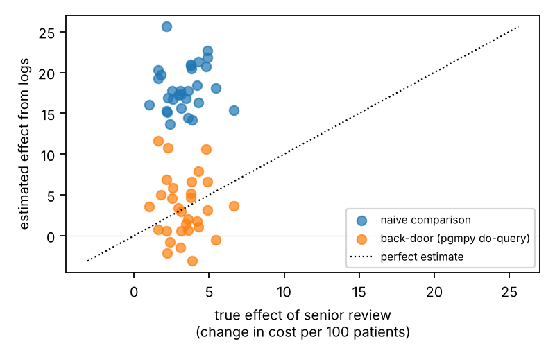

# human-ai-protocols-icu

When is a human-AI team in the ICU epistemically reliable, and how should the interaction between clinicians and an AI system be designed so that it is?

This project models human-AI interaction **protocols** for ICU mortality-risk decisions. It combines four ingredients.

1. **A real AI agent** trained on real ICU stays (PhysioNet/CinC Challenge 2012).
2. **Simulated clinician agents** (junior and senior) whose judgments follow the lens model of human judgment, with explicit, varied assumptions about inconsistency and reliance on AI advice.
3. **Mathematical optimisation** (a linear program in CVXPY) that chooses how each case is routed under capacity, human-oversight, governance and epistemic constraints.
4. **A causal-probabilistic model** (pgmpy) of interaction logs, used to show how naive analysis of observational human-AI logs goes wrong and how back-door adjustment corrects it.

```
patient (real ICU record)
   ├── charted vitals and labs ──────────► AI agent (calibrated gradient-boosted trees)
   └── bedside cues incl. neuro exam ───► clinician agents (junior / senior, simulated)
                                               │
                       interaction protocol ◄──┘  (who decides, who sees what first,
                                                    when to escalate)
                                               │
                                               ▼
                         decision (flag high risk or not) ──► cost (missed death = 5, false alarm = 1)
```

## Why this design

The neurological exam (Glasgow Coma Scale) is withheld from the AI and available to the clinician. SAPS-I and SOFA are also withheld from the AI because both contain a GCS component. This creates an **information asymmetry**, which is one of the recognised sources of human-AI complementarity. The ablation below removes it to test whether it is really what drives the results.

The project is connected to the epistemology of human-AI interaction. Ferrario, Facchini and Durán (AIES 2026) argue that complementarity should be treated as one reliability indicator among others, such as stability under updates, rather than as a stand-alone accuracy claim. Several experiments below test exactly those indicators.

## What is real and what is simulated

| Component | Status |
|---|---|
| ICU records (4,000 + 4,000 stays), outcomes | Real (PhysioNet 2012 Set A and Set B, see `data/PROVENANCE.md`) |
| AI risk model | Real model, trained on Set A, evaluated on held-out Set B |
| Clinician judgments | **Simulated.** Lens-model agents (logistic model on bedside cues plus inconsistency noise), advice-taking by weight on advice |
| Interaction logs for the causal analysis | **Simulated** from the agents above under a stated status-quo routing policy |

No claim is made about how real clinicians behave. The clinician parameters are assumptions, and the sensitivity analysis shows which conclusions depend on them.

## Setup

* The decision is whether to flag a patient as high mortality risk. A missed death costs 5, a false alarm costs 1. Every agent flags when its risk exceeds 1/6, the cost-optimal threshold for a calibrated risk.
* Set A is split into a training part (AI and clinician cue model) and an optimisation part (LP cost estimates). Set B is used only for final evaluation.
* 30 simulation seeds on Set B. All protocols share the same random draws within a seed, so protocol comparisons are paired. Confidence intervals are 95% patient-level bootstrap intervals.

| Agent (Set B) | AUROC |
|---|---|
| AI, calibrated GBT without neuro exam (ECE 0.011) | 0.826 |
| Clinician cue model, noise-free | 0.788 |
| Junior's own judgment (sigma = 1.0) | 0.724 |
| Senior's own judgment (sigma = 0.5) | 0.768 |

## Protocols compared

| Protocol | What happens |
|---|---|
| `ai_auto` | AI decides alone |
| `junior_alone`, `senior_alone` | Clinician decides without AI |
| `junior_advice_first` | Junior sees the AI risk before forming a view (anchoring, weight on advice 0.6) |
| `junior_blind_first` | Junior commits to a view first, then sees the AI (weight on advice 0.3) |
| `senior_blind_first` | Same for the senior (weight on advice 0.2) |
| `confidence_deferral` | AI decides when far from the threshold, otherwise junior blind-first (about 30% of cases deferred) |
| `escalate_on_disagreement` | Junior commits, then sees the AI. If they disagree, a senior decides |
| **optimised (LP)** | Per-cell routing chosen by the linear program |

## Results

### 1. Protocol choice matters more than the presence of a human

Decision cost per 100 patients on held-out Set B (lower is better), with the paired difference to the best individual agent (the AI).

| Protocol | Cost / 100 | Difference vs AI alone [95% CI] | Junior reviews | Senior reviews |
|---|---|---|---|---|
| confidence_deferral | 38.2 | −2.4 [−4.4, −0.3] | 30% | 0% |
| **optimised (LP)** | **38.4** | **−2.2 [−4.3, −0.2]** | 50% | 8% |
| junior_advice_first | 39.0 | −1.6 [−3.4, +0.3] | 100% | 0% |
| ai_auto | 40.6 | reference | 0% | 0% |
| escalate_on_disagreement | 40.7 | +0.1 [−2.1, +2.4] | 100% | 32% |
| senior_blind_first | 42.4 | +1.8 [−1.0, +4.7] | 0% | 100% |
| junior_blind_first | 45.1 | +4.5 [+2.0, +7.0] | 100% | 0% |
| senior_alone | 46.8 | +6.2 [+3.1, +9.5] | 0% | 100% |
| junior_alone | 52.5 | +11.9 [+8.8, +14.9] | 100% | 0% |



"Blind-first" is often recommended as a guard against anchoring on AI advice. Here it is the worst team protocol. The calibrated AI is more reliable than the junior, so a protocol that makes the junior rely less on the AI loses information. Whether anchoring is harmful depends on the relative reliability of the two agents, not on the protocol alone.

### 2. Where complementarity exists

Team (junior with AI advice) cost minus the best individual, over a grid of clinician inconsistency and weight on advice. Blue cells are complementarity.



Complementarity exists only in a band. The more inconsistent the clinician, the more weight the AI advice must receive for the team to beat both members. A very consistent clinician gains from moderate reliance, a noisy one only from heavy reliance. This is a quantitative version of the idea that reliance should be calibrated to the reliability of each agent.

### 3. Optimised routing under governance constraints

The LP routes each AI risk decile to one or more actions, subject to

* senior capacity of at most 10% of patients,
* junior capacity of at most 50% of patients,
* a human in the loop for at least 50% of patients,
* no automated decision for the two highest-risk deciles (governance),
* automation only in deciles where the AI's calibration gap is below 0.05 on the optimisation split (epistemic constraint, i.e. automate only where reliability is evidenced).

On Set B the optimised policy is significantly better than the AI alone (−2.2 [−4.3, −0.2]) and than escalation on disagreement (−2.3 [−3.5, −1.1]), while using 8% senior reviews instead of 32%.

It is **not** better than simple confidence deferral (difference +0.2 [−0.6, +1.0]). Confidence deferral reaches the same cost with fewer reviews, but it keeps a human in the loop for only about 30% of patients, so it violates the oversight constraint. The LP's contribution is to reach that level of cost while satisfying all the constraints. The LP picks low-risk deciles for automation and sends high-risk deciles to junior review with AI advice shown first, plus one middle decile to senior review.



Expected cost on the optimisation split (35.6) is lower than realised cost on Set B (38.4). A fixed protocol (escalation on disagreement) shows a similar gap between the two cohorts (37.6 vs 40.7), so most of the gap reflects the cohort rather than overfitting of the LP. Extra senior capacity buys very little once routing is optimised (38.8 at 0% vs 38.1 at 30%).

### 4. Ablation. What if the AI also sees the neurological exam?

| | AI AUROC | AI alone | best team protocol | complementarity (advice-first / blind-first / senior) |
|---|---|---|---|---|
| AI without neuro exam (main) | 0.826 | 40.6 | 38.2 | −1.6 / +4.5 / +1.8 |
| AI with neuro exam | 0.854 | 36.2 | 36.7 | +1.4 / +7.9 / +5.8 |

Once the AI has the neurological exam, no team protocol beats the AI alone. In this setting the information asymmetry is the source of complementarity, not the human's presence as such.

### 5. Stability under a model update

The protocols are re-evaluated with two alternative AI models. Kendall's tau compares the protocol ranking with the main model.

| AI model | AUROC | ECE | AI alone | Kendall tau vs main | advice-first complementarity |
|---|---|---|---|---|---|
| Calibrated GBT (main) | 0.826 | 0.011 | 40.6 | 1 | −1.6 |
| Logistic regression | 0.809 | 0.031 | 41.3 | 0.86 (p = 0.002) | −1.8 |
| GBT without calibration | 0.816 | 0.094 | 50.6 | 0.14 (p = 0.72) | −3.1 |

With the uncalibrated model, every team protocol appears to show strong complementarity (up to −5.9) and the protocol ranking is essentially reshuffled. The humans are mostly compensating for the AI's miscalibration. A complementarity result measured on one model version is therefore weak evidence about the next one, and calibration of the AI should be checked before complementarity is interpreted. This matches the view that complementarity has to be read together with other reliability indicators such as stability under updates.

### 6. Causal analysis of confounded interaction logs

Under a stated status-quo policy, seniors review sicker patients and cases where the AI is uncertain more often. The question is the effect of senior review (vs junior with AI advice first) on decision cost. The simulation provides the true effect, because every patient can be run through both arms.

The causal graph is `Sev → Unc`, `Sev → Review ← Unc`, `Sev → Out`, `Unc → Out`, `Review → Out`. pgmpy finds the adjustment set {Sev, Unc} and answers `P(Out | do(Review))`.

| Estimate (30 runs) | Effect on cost / 100 | Mean absolute error |
|---|---|---|
| True effect | +3.3 | |
| Naive comparison of logs | +18.2 | 14.8 |
| Back-door adjustment (pgmpy) | +3.5 | 3.3 |



The naive comparison exaggerates the harm of senior review more than fivefold, because senior-reviewed cases are the hard ones. Back-door adjustment recovers the true effect on average. Individual back-door estimates are still noisy (5 of 30 runs have the wrong sign), since the true effect is small relative to the sampling noise of about 1,250 senior-reviewed cases per log. The true effect is positive under these parameters because the senior, reviewing blind-first, gives less weight to an AI that is more reliable than the senior's own judgment.

## Limitations

* Clinicians are simulated. Their parameters (inconsistency, weight on advice) are assumptions, not estimates from real clinician behaviour. Conclusions 1 and 2 depend on the relative reliability of AI and clinician, and the sensitivity map shows how.
* The causal graph is correct by construction, because the logs are generated from it. Real interaction logs would contain unobserved confounders, and identification would need more care (for example sensitivity analysis or instrumental variables).
* One dataset, one decision, one cost ratio. The second application domain of the motivating project (cybersecurity) is not covered.
* The data is aggregated per stay (see the sibling repository `icu-mortality-trustworthy-eval`), so this is not a time-series model and decisions are made once per stay.
* The LP optimises over cells of AI risk only. Richer cell definitions (for example ICU type or disagreement) are a natural extension.

## Reproduce

```
pip install -r requirements.txt
python scripts/run_all.py      # about 20 seconds on CPU, writes results/
python -m pytest -q tests      # sanity checks for protocols and LP constraints
```

## Repository layout

```
hai/data.py        data loading and the AI / clinician information split
hai/agents.py      AI agent, cue model, clinician agents (lens model + advice taking)
hai/protocols.py   routing actions, protocols, cost metrics
hai/optimise.py    linear program (CVXPY) for constrained routing
hai/causal.py      confounded logs, causal graph and back-door estimate (pgmpy)
scripts/run_all.py all experiments and figures
results/           results.json and figures
tests/             sanity checks
```

## References

* Ferrario, A., Facchini, A., Durán, J. M. (2026). Epistemology Gives a Future to Complementarity in Human-AI Interactions. AIES 2026.
* Hammond, K. R. (1955). Probabilistic functioning and the clinical method. Psychological Review. (lens model of clinical judgment)
* Silva, I., Moody, G., Scott, D. J., Celi, L. A., Mark, R. G. (2012). Predicting in-hospital mortality of ICU patients. The PhysioNet/Computing in Cardiology Challenge 2012.
* Pearl, J. (2009). Causality. Cambridge University Press.
