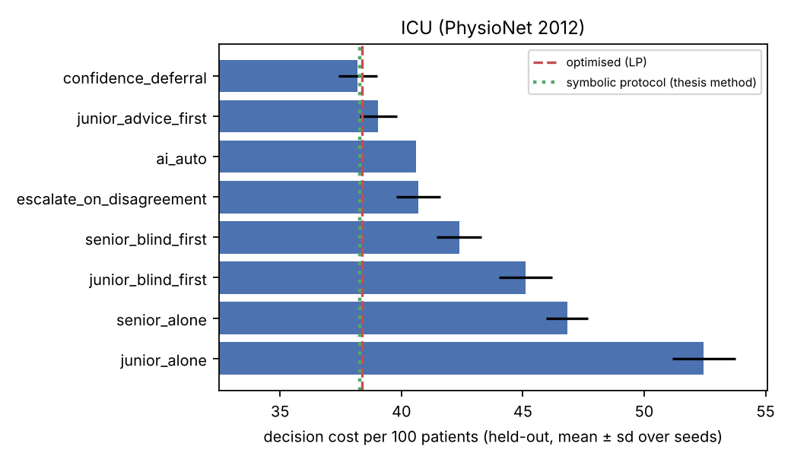
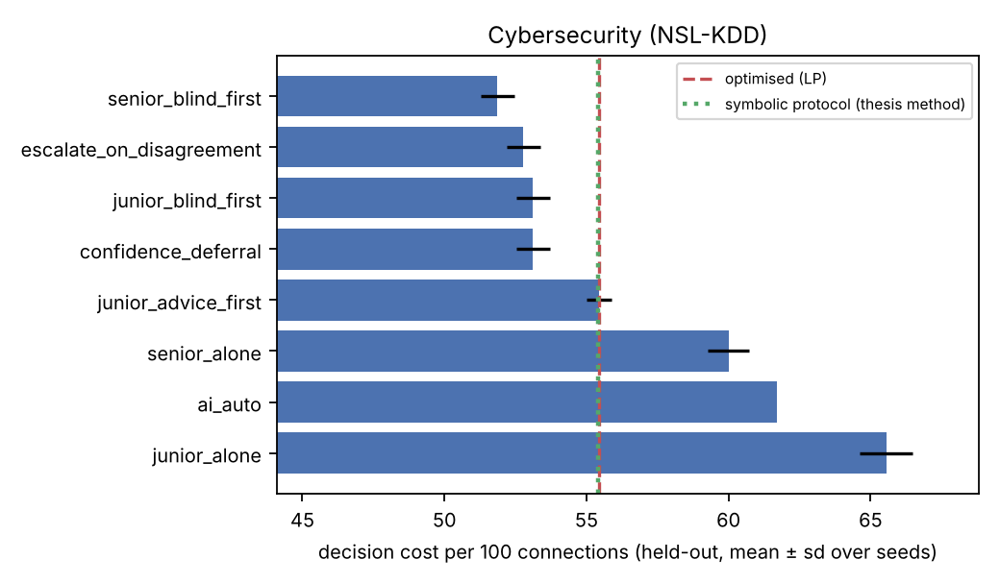
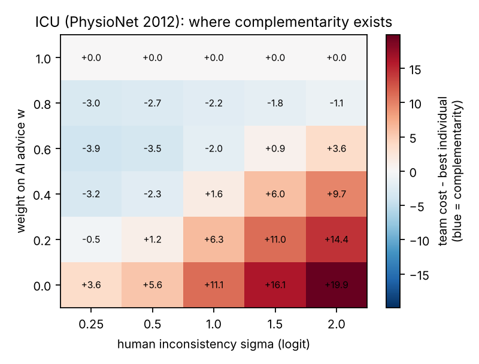
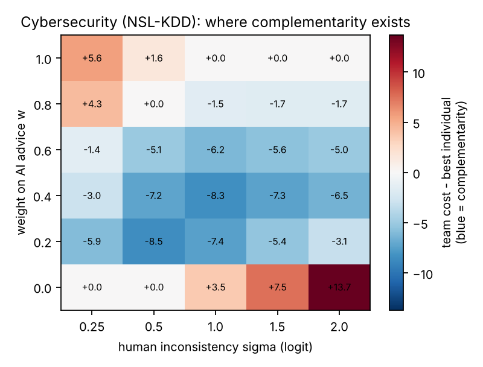
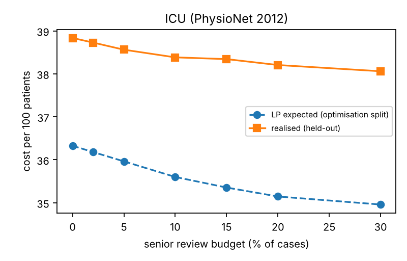
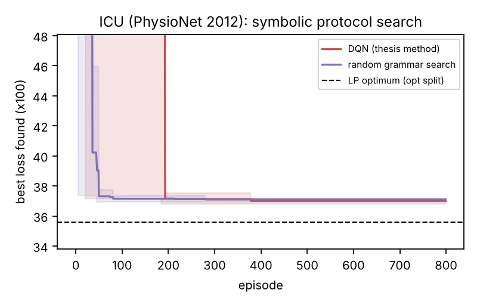
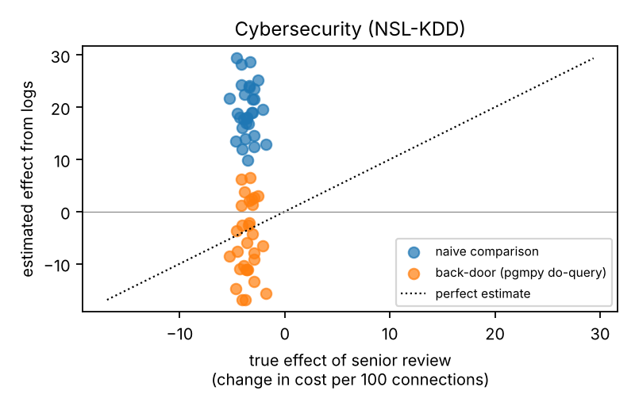

# human-ai-protocols

When is a human-AI team epistemically reliable, and how should the interaction between people and an AI system be designed so that it is?

This project represents, optimises and evaluates **human-AI interaction protocols** in two application domains, **intensive care** and **cybersecurity alert triage**, using real data in both. It combines five ingredients.

1. **Real AI agents** trained on real records (PhysioNet/CinC 2012 ICU stays, NSL-KDD network connections).
2. **A multi-agent simulation** in which the AI interacts with simulated junior and senior human agents. Their judgments follow the lens model of human judgment, with explicit assumptions about inconsistency and reliance on AI advice.
3. **Mathematical optimisation** (a linear program in CVXPY) that routes cases under capacity, human-oversight, governance and epistemic constraints.
4. **Symbolic protocol synthesis with the method of my M.Sc. thesis.** A grammar of protocols, explored by a DQN agent, produces short and auditable rules whose thresholds are fitted inside the loop.
5. **A causal-probabilistic model** (pgmpy) of interaction logs. It shows how naive analysis of observational human-AI logs misleads and how back-door adjustment corrects it.

```
case (real record)
   ├── features available to the AI ─────────► AI agent (calibrated gradient-boosted trees)
   └── private information of the human ─────► junior / senior agents (simulated)
                                                  │
         interaction protocol  ◄──────────────────┘   who decides, who sees what first,
         (hand-designed, LP-optimised,                 when to escalate, what to audit
          or synthesised by symbolic RL)
                                                  │
                                                  ▼
               decision (flag or not) ──► cost (missed positive = C_FN, false alarm = C_FP)
```

## Relation to my M.Sc. thesis

My thesis ([Symbolic-RL-Fredholm-Solver](https://github.com/saqarkpr/Symbolic-RL-Fredholm-Solver)) solved second-kind Fredholm integral equations by letting a DQN agent build closed-form solutions inside a context-free grammar. `hai/symbolic.py` transfers that method from mathematical expressions to interaction protocols.

| | Thesis | This project |
|---|---|---|
| Search space | Context-free grammar of expressions | Context-free grammar of protocols (decision lists) |
| Terminals | Variable `x`, learnable constants `w_i` | Conditions on AI risk, AI uncertainty, disagreement, random audit, each with a learnable threshold `w_i` |
| Agent | DQN choosing production rules, state = padded action sequence, MLP 128-128, replay buffer, target network | Same |
| Inner fit | L-BFGS on the constants | Coordinate search on the thresholds (the cost is not differentiable) |
| Fitness | Residual of the integral equation | Simulated decision cost plus penalties for violated constraints |
| Reward | `1 / (loss + 1e-5)` | Same |
| Output | Interpretable closed-form solution | Interpretable, auditable protocol |
| Comparison | PINN and PI-KAN (accurate but not interpretable) | LP optimum (optimal but randomised and not readable) |

A random grammar search with the same number of episodes is run as a control, to separate the value of the DQN from the value of the grammar.

## Two domains

| | Intensive care | Cybersecurity |
|---|---|---|
| Data | PhysioNet/CinC Challenge 2012, Set A and Set B | NSL-KDD, KDDTrain+ and KDDTest+ |
| Case, positive | ICU stay, in-hospital death | Network connection, intrusion |
| AI sees | Charted vitals and labs | Connection features and traffic statistics |
| Only the human sees | Neurological exam (Glasgow Coma Scale). SAPS-I and SOFA are also withheld from the AI because they contain a GCS component | Host and session content (failed logins, root shells, file activity, "hot" indicators) |
| Costs | Missed death 5, false alarm 1 | Missed intrusion 10, false alarm 1 |
| Held-out set | Set B (4,000 stays), same distribution | KDDTest+ (12,139 connections), contains attack types never seen in training |
| Prevalence | 14% | 20% (attacks subsampled, see `data/cyber/PROVENANCE.md`) |

| Agent, held-out AUROC | ICU | Cyber |
|---|---|---|
| AI | 0.826 (ECE 0.011) | 0.941 (ECE 0.092) |
| Human cue model, noise-free | 0.788 | 0.838 |
| Junior's own judgment | 0.724 | 0.836 |
| Senior's own judgment | 0.768 | 0.843 |

The same human parameters are used in both domains (junior inconsistency 1.0 logit, weight on AI advice 0.6 when shown first and 0.3 when blind-first; senior 0.5, 0.4 and 0.2). In the cyber domain the cue logits have a much larger spread, so the same inconsistency costs the analysts less discrimination.

## What is real and what is simulated

| Component | Status |
|---|---|
| Records and outcomes | Real |
| AI risk models | Real models, trained on training splits, evaluated on held-out splits |
| Human judgments | **Simulated** lens-model agents with advice taking |
| Interaction logs for the causal analysis | **Simulated** from the agents under a stated status-quo routing policy |

No claim is made about how real clinicians or analysts behave. The sensitivity analysis shows which conclusions depend on the human parameters.

## Setup

* Every agent flags a case when its risk exceeds `C_FP / (C_FP + C_FN)`, the cost-optimal threshold for a calibrated risk.
* Each domain has a training split (AI and human cue model), an optimisation split (protocol design) and a held-out split (final evaluation only).
* 30 simulation seeds on the held-out split. All protocols share the same random draws within a seed, so comparisons are paired. Confidence intervals are 95% case-level bootstrap intervals.

| Protocol | What happens |
|---|---|
| `ai_auto` | AI decides alone |
| `junior_alone`, `senior_alone` | Human decides without AI |
| `junior_advice_first` | Junior sees the AI risk before forming a view (anchoring) |
| `junior_blind_first`, `senior_blind_first` | Human commits to a view first, then sees the AI |
| `confidence_deferral` | AI decides when far from the threshold, otherwise junior blind-first (about 30% of cases) |
| `escalate_on_disagreement` | Junior commits, then sees the AI. If they disagree, a senior decides |
| **LP** | Cell-wise randomised routing chosen by the linear program |
| **symbolic** | Decision list synthesised by the thesis method |

## Results

### 1. Which protocol is best depends on the domain and on relative reliability

Decision cost per 100 held-out cases, and the paired difference to the AI alone (the best individual agent in both domains).

| Protocol | ICU cost | vs AI [95% CI] | Cyber cost | vs AI [95% CI] |
|---|---|---|---|---|
| ai_auto | 40.6 | reference | 61.7 | reference |
| junior_alone | 52.5 | +11.9 [+8.8, +14.9] | 65.5 | +3.9 [+1.0, +6.8] |
| senior_alone | 46.8 | +6.2 [+3.1, +9.5] | 60.0 | −1.7 [−4.7, +1.5] |
| junior_advice_first | 39.0 | −1.6 [−3.4, +0.3] | 55.4 | −6.3 [−7.7, −4.9] |
| junior_blind_first | 45.1 | +4.5 [+2.0, +7.0] | 53.1 | −8.6 [−10.4, −6.8] |
| senior_blind_first | 42.4 | +1.8 [−1.0, +4.7] | 51.9 | −9.8 [−11.8, −7.9] |
| confidence_deferral | 38.2 | −2.4 [−4.4, −0.3] | 53.1 | −8.6 [−10.4, −6.8] |
| escalate_on_disagreement | 40.7 | +0.1 [−2.1, +2.4] | 52.8 | −8.9 [−10.7, −7.2] |
| LP (optimised) | 38.4 | −2.2 [−4.3, −0.2] | 55.4 | −6.3 [−7.7, −4.9] |
| symbolic (thesis method) | 38.3 | −2.3 [−4.2, −0.4] | 55.4 | −6.3 [−7.7, −4.9] |




In the ICU the calibrated AI is more reliable than the junior, so protocols that make the junior rely less on the AI (blind-first) lose information. In cybersecurity the opposite holds on the held-out set, because the AI fails on attack types it never saw, and blind-first review by humans is the strongest protocol family. "Blind-first" is therefore not good or bad in itself. Its value depends on the relative reliability of the agents in the deployment conditions.

### 2. Where complementarity exists

Team (junior with AI advice) cost minus the best individual, over a grid of human inconsistency and weight on AI advice. Blue cells are complementarity.




Complementarity exists only in a band of reliance. In the ICU the band moves towards heavier reliance as the human becomes less consistent. In cybersecurity the band sits at low to moderate reliance, because under distribution shift the AI is the agent whose errors need correcting. Reliance has to be calibrated to the reliability of each agent, and that reliability differs between domains.

### 3. Optimised routing under governance constraints (LP)

The LP routes each AI-risk decile subject to

* senior capacity of at most 10% of cases,
* junior capacity of at most 50% of cases,
* a human in the loop for at least 50% of cases,
* no automated decision for the two highest-risk deciles (governance),
* automation only in deciles where the AI's calibration gap is below 0.05 on the optimisation split (an epistemic constraint, automate only where reliability is evidenced).

**ICU.** The LP is significantly better than the AI alone (−2.2 [−4.3, −0.2]) and than escalation on disagreement (−2.3 [−3.5, −1.1]), using 8% senior reviews instead of 32%. Simple confidence deferral is as good (difference +0.2 [−0.6, +1.0]) but keeps a human in the loop for only about 30% of patients, so it violates the oversight constraint.

**Cyber.** The LP is significantly *worse* than escalation on disagreement (+2.6 [+1.7, +3.6]) on the held-out set. Its expected cost on the optimisation split was 0.7 per 100. The AI misses no attack at all on in-distribution data, and the LP rationally automates the low-risk cases. On KDDTest+ the AI misses 30% of attacks, many with a risk of exactly zero. Every constraint, including the epistemic one, was satisfied on the evidence the LP was given. That evidence did not represent the deployment conditions. Section 5 tests this directly.



### 4. Symbolic protocols with the thesis method

Five DQN runs and five random-search runs per domain (800 episodes each, same grammar, same fitness). The protocol with the lowest loss on the optimisation split is evaluated on the held-out split.

**ICU, selected protocol (two conditions).**

```
if AI risk < 0.0905:            ai_auto
elif AI uncertain (band 0.10):  senior_blind_first
else:                           junior_advice_first
```

Held-out cost 38.3, statistically indistinguishable from the LP (−0.1 [−0.6, +0.4]) and significantly better than the AI alone (−2.3 [−4.2, −0.4]). It satisfies every constraint on the held-out set (52% human in the loop, 5% senior reviews, no automation of the top-risk deciles). Unlike the LP, a person can read and audit it.

**Cyber, selected protocol (two conditions).**

```
if AI risk >= 0.000441:                  junior_advice_first
elif random audit (fraction 0.1):        senior_blind_first
else:                                    ai_auto
```

In the optimisation data 52% of connections have an AI risk of exactly zero. A deterministic threshold cannot split those tied cases, so without an audit condition no rule can meet the 50% oversight requirement. The LP meets it only by randomising which of them a human sees. Adding **random audit sampling** to the grammar lets the symbolic protocols state that randomisation openly. The selected rule matches the LP on the held-out set (−0.01 [−0.04, +0.01]), but under the distribution shift its human-in-the-loop share falls to 44%, below the required 50%. Constraint satisfaction measured in-distribution did not transfer.

**DQN versus random search.** The DQN found a lower-loss protocol than random search on 4 of 5 seeds in each domain, but with five seeds this is not significant (Wilcoxon p = 0.44 in both). The protocol grammar is small, and random search already explores it well. The contribution of the thesis method here is the **representation**, readable protocols with fitted thresholds at LP-level cost. A clear advantage of the learned search would need a larger grammar, which is a natural next step.



### 5. Where should the evidence for designing a protocol come from?

The held-out split is halved. One half plays the role of evidence collected under deployment conditions, the other half is the test. The LP is designed once on in-distribution evidence and once on deployment evidence, and both are evaluated on the same test half.

| | ICU (no shift) | Cyber (shift) |
|---|---|---|
| AI misses among positives, optimisation split vs held-out | 26% vs 25% | 0% vs 30% |
| LP designed on in-distribution evidence | 40.0 | 55.3 |
| LP designed on deployment evidence | 41.9 | 50.0 |
| Deployment minus in-distribution [95% CI] | +1.9 [−0.1, +3.8] | **−5.3 [−7.3, −3.2]** |
| Best fixed protocol on the test half | 42.0 (escalation) | 51.1 (senior blind-first) |

In cybersecurity, designing on evidence that reflects deployment conditions makes the optimised protocol significantly better, and it then also beats the best hand-designed protocol (−2.2 [−3.8, −0.5] against escalation). In the ICU, where there is no shift, it brings no benefit. The reliability evidence behind an epistemic constraint is only as good as its match to the conditions of use.

### 6. Sources of complementarity (ablation)

The AI is retrained with the human's private information.

| | ICU | Cyber |
|---|---|---|
| AI AUROC without / with private information | 0.826 / 0.854 | 0.941 / 0.948 |
| Best team protocol vs AI alone, with private information | no team beats the AI (best is +0.6) | team still better (−11.3, senior blind-first) |

In the ICU, complementarity disappears once the AI has the neurological exam, so information asymmetry is its source. In cybersecurity it survives, so its main source there is the AI's failure on novel attacks, which humans still catch. The same protocol question has different answers because complementarity has different sources.

### 7. Stability under a model update

| AI model | ICU AUROC / ECE / AI-alone cost | ICU Kendall τ vs main | Cyber AUROC / ECE / AI-alone cost | Cyber Kendall τ vs main |
|---|---|---|---|---|
| Calibrated GBT (main) | 0.826 / 0.011 / 40.6 | 1 | 0.941 / 0.092 / 61.7 | 1 |
| Logistic regression | 0.809 / 0.031 / 41.2 | 0.86 (p = 0.002) | 0.847 / 0.122 / 70.5 | 0.62 (p = 0.03) |
| GBT without calibration | 0.816 / 0.094 / 50.6 | 0.14 (p = 0.72) | 0.954 / 0.094 / 71.2 | 0.84 (p = 0.004) |

In the ICU, the uncalibrated update produces apparent complementarity for every team protocol (up to −5.9) and reshuffles the protocol ranking, because the humans mostly correct the AI's miscalibration. A complementarity result measured on one model version is therefore weak evidence about the next one. This matches the view that complementarity has to be read together with other reliability indicators such as stability under updates (Ferrario, Facchini and Durán, AIES 2026).

### 8. Causal analysis of confounded interaction logs

Under a stated status-quo policy, senior review is requested more often for cases with higher observed severity (SAPS-I terciles in the ICU, a rule-based legacy priority score in cybersecurity) and when the AI is uncertain. The question is the effect of senior review (vs junior with AI advice first) on decision cost. The simulation provides the true effect, because every case can be run through both arms.

The causal graph is `Sev → Unc`, `Sev → Review ← Unc`, `Sev → Out`, `Unc → Out`, `Review → Out`. pgmpy finds the adjustment set {Sev, Unc} and answers `P(Out | do(Review))`.

| Effect of senior review on cost / 100 (30 runs) | ICU | Cyber |
|---|---|---|
| True effect | +3.3 | −3.6 |
| Naive comparison of logs | +17.1 | +19.4 |
| Back-door adjustment (pgmpy) | +3.2 | −5.5 |
| Naive estimate with the wrong sign | 0 / 30 runs | **30 / 30 runs** |
| Back-door estimate with the wrong sign | 7 / 30 runs | 9 / 30 runs |



In cybersecurity, senior review truly reduces cost, yet the naive reading of the logs says it increases cost in every single run, because seniors receive the hardest cases. Back-door adjustment recovers the correct sign on average. Individual adjusted estimates remain noisy, because the true effects are small relative to the sampling noise of one log. In the ICU, senior review truly increases cost under these parameters (the senior, reviewing blind-first, gives less weight to an AI that is more reliable than the senior's own judgment), and the naive comparison exaggerates this about fivefold.

## Limitations

* Humans are simulated. Their parameters are assumptions, not estimates from real clinicians or analysts. The sensitivity maps show how conclusions 1 and 2 depend on them.
* The causal graph is correct by construction, because the logs are generated from it. Real logs contain unobserved confounders, and identification would need sensitivity analysis or other designs.
* Each domain has one decision and one cost ratio. NSL-KDD is old and synthetic and serves as a controlled testbed, not as a statement about modern intrusion detection.
* The ICU data is aggregated per stay (see `icu-mortality-trustworthy-eval`), so decisions are made once per stay, not over time.
* The symbolic search uses five seeds per method, which is too few to detect a modest advantage of the DQN over random search.

## Reproduce

```
pip install -r requirements.txt
python scripts/run_all.py --domain all     # about 10 minutes on CPU, writes results/icu and results/cyber
python -m pytest -q tests                  # 14 sanity checks
```

## Repository layout

```
hai/domains/icu.py     ICU data and the AI / clinician information split
hai/domains/cyber.py   NSL-KDD data and the AI / analyst information split
hai/agents.py          AI agent, human cue model, human agents (lens model + advice taking)
hai/protocols.py       routing actions, protocols, costs and metrics
hai/optimise.py        linear program (CVXPY) for constrained routing
hai/symbolic.py        protocol grammar + DQN synthesis (method of the M.Sc. thesis)
hai/causal.py          confounded logs, causal graph, back-door estimate (pgmpy)
scripts/run_all.py     all experiments and figures
results/<domain>/      results.json and figures
data/<domain>/         data files and PROVENANCE.md
tests/                 sanity checks
```

## References

* Ferrario, A., Facchini, A., Durán, J. M. (2026). Epistemology Gives a Future to Complementarity in Human-AI Interactions. AIES 2026.
* Hammond, K. R. (1955). Probabilistic functioning and the clinical method. Psychological Review. (lens model of clinical judgment)
* Khalilpour, S. (2025). Solving Second-Kind Fredholm Integral Equations Using a Combination of Reinforcement Learning and Context-Free Grammars. M.Sc. thesis, Shahid Beheshti University.
* Silva, I., Moody, G., Scott, D. J., Celi, L. A., Mark, R. G. (2012). Predicting in-hospital mortality of ICU patients. PhysioNet/Computing in Cardiology Challenge 2012.
* Tavallaee, M., Bagheri, E., Lu, W., Ghorbani, A. A. (2009). A Detailed Analysis of the KDD CUP 99 Data Set. CISDA 2009.
* Pearl, J. (2009). Causality. Cambridge University Press.
